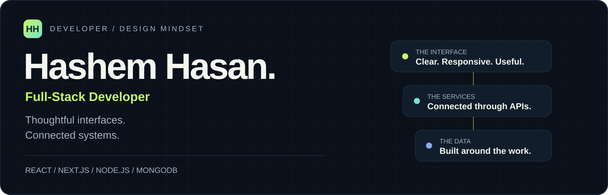
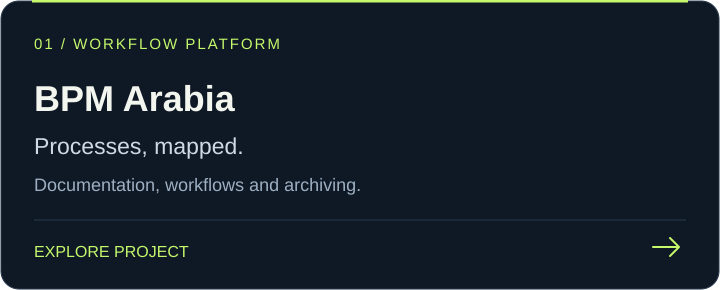
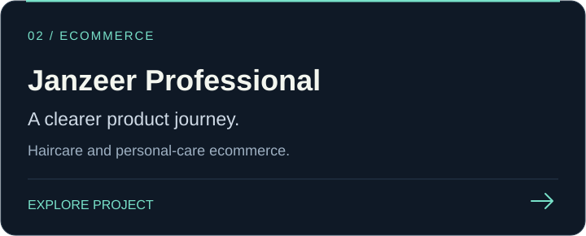
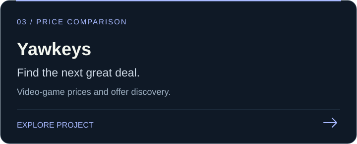
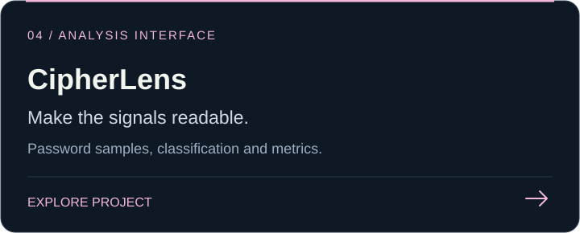

  <picture>
    <source media="(prefers-color-scheme: light)" srcset="./assets/hero-light.svg">
    
  </picture>

  
  
  

<strong>Based in Jordan · Open to remote work worldwide · Arabic & English</strong>

 

## From the interface to the database.

I'm **Hashem**, a full-stack developer working with **React, Next.js, Node.js, Express and MongoDB**. I turn business requirements into responsive interfaces, connected APIs and practical web products.

My background in multimedia design shapes how I approach the frontend: clear visual hierarchy, usable flows and attention to the details people actually interact with. I'm also pursuing a degree in **Data Science and Artificial Intelligence** at Al Al-Bayt University.

 

<table>
  <tr>
    <td width="33%" valign="top"><h3>01 / Interfaces</h3>
React & Next.js applications, responsive layouts, reusable components, state management and server-side rendering.
</td>
    <td width="33%" valign="top"><h3>02 / Systems</h3>
Node.js & Express services, RESTful APIs, authentication, MongoDB data models and frontend–backend integration.
</td>
    <td width="33%" valign="top"><h3>03 / Craft</h3>
UI/UX principles, performance work, systematic debugging and a visual background in Photoshop, Premiere and After Effects.
</td>
  </tr>
</table>

 

## Selected work

Live projects from my [Tarneeb Tech portfolio](https://www.tarneebtech.com/). Client source repositories remain private.

<table>
  <tr>
    <td width="50%"></td>
    <td width="50%"></td>
  </tr>
  <tr>
    <td width="50%"></td>
    <td width="50%"></td>
  </tr>
</table>

**Also in the portfolio:** [Mouj Al Bahr](https://www.mojalbahr.com/ar) · [Growth Point](https://www.growthpointjo.com/) · [Dallas Phone Resale](https://dallasphoneresale.vercel.app/) · [Haqqi](https://majdaljamzawe.tarneebtech.com/)

 

## My working stack

  
  
  
  
  
  
  
  

| Frontend | Backend & data | Development & design |
| :--- | :--- | :--- |
| React · Next.js · JavaScript (ES6+) | Node.js · Express · REST APIs | Git · GitHub · Code review |
| HTML5 · CSS3 · Tailwind · SASS/LESS | MongoDB · Mongoose · Data modeling | Responsive design · UI/UX principles |
| Redux · Context API · Axios · Fetch | Authentication · Authorization | Debugging · Performance optimization |
| Server-side rendering · Component architecture | Query optimization · API integration | Photoshop · Premiere · After Effects |

 

## Let's build something useful.

I'm open to remote **full-stack, frontend, web and integration development** opportunities, along with relevant creative and practical AI work.

**[See my portfolio →](https://www.tarneebtech.com/)** &nbsp;&nbsp; **[Connect on LinkedIn →](https://www.linkedin.com/in/hashem-hasan)** &nbsp;&nbsp; **[Email me →](mailto:cozlgames@gmail.com)**

 

Thoughtful interfaces. Connected systems. Work you can explore.

